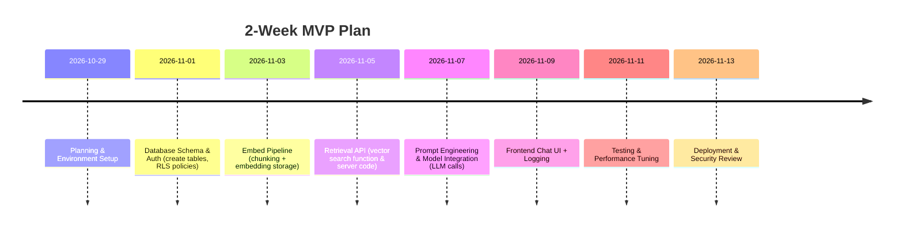

# Secure AI-Powered Q&A Feature for Hourly-Psi (Vercel + Supabase)

## Executive Summary 
- **Overview:** Build a “ask anything” AI chat by combining Supabase (Postgres) data and a large language model (LLM).  Users authenticate via Supabase Auth; queries trigger a serverless function on Vercel that retrieves relevant user/app data (via vector search) and calls the LLM for an answer.   
- **Key Components:** Supabase Auth + Row-Level Security (RLS) for per-user data isolation; a Postgres `vector` column (pgvector) to index embeddings; a vector similarity search (via pgvector or external DB) for retrieval; prompt engineering to ground the LLM in retrieved content; secure secret management (API keys in Vercel env vars); and logging/audit for monitoring.  
- **Security:** Enforce access controls at retrieval time (RLS policies such as `auth.uid() = user_id`), tag or exclude PII in embeddings, never expose secret keys client-side, and maintain audit logs of queries and responses.  
- **Performance & Cost:** Each query involves one embedding call and one LLM call. Typical latency is a few hundred milliseconds (depending on model). Embedding and model costs scale with usage (e.g. tens of cents per 1K tokens on modern LLMs). We provide rough estimates and ensure caching/reuse where possible.  
- **Implementation Plan:** A 2-week MVP roadmap (below) covers setup (auth, RLS policies), indexing pipeline, retrieval API, frontend integration, testing, and deployment. Code snippets illustrate TypeScript serverless handlers and SQL policies. 

## Architecture & Data Sources 
We leverage two main data sources: **(A)** Supabase (a hosted Postgres DB with pgvector and RLS) for user/app data, and **(B)** an external LLM API (e.g. OpenAI/Gemini). The Vercel app (e.g. a Next.js frontend + API routes or edge functions) acts as the glue. The frontend calls a secure backend endpoint with the user question. The backend: (1) fetches any relevant records from Supabase, (2) performs a vector similarity search on embedded data, and (3) constructs a prompt combining retrieved content and the question for the LLM.  Results (answer + source references) are returned to the frontend.  

 *Figure:* Typical Retrieval-Augmented Generation (RAG) pipeline. Data is ingested and embedded into a vector store. On user query, the system retrieves relevant context from the store and feeds it to the LLM. 

**Supabase Connector:** We use Supabase’s JavaScript client (server-side) with the Service Role key to read/write private data and the anon key for public read. The Supabase *site URL* and *redirect URLs* must be set in the Supabase Dashboard under *Authentication → URL Configuration* (e.g. set Site URL to `https://hourly-psi.vercel.app`). This ensures OAuth redirects and CORS are correctly configured. All Supabase access (SQL and RPC calls) happens from the Vercel backend, not the browser, so secrets stay safe. 

**LLM Provider:** Use your chosen LLM via its API (e.g. OpenAI, Gemini). Store the model API key (and optional organization ID) in Vercel’s Environment Variables (e.g. `OPENAI_API_KEY` or `GEMINI_API_KEY`). Mark these as *Secret* in Vercel so they are write-only. The frontend does not see these keys; only the serverless function has access. 

## Authentication and Sessions 
- **User Sign-in:** Use Supabase Auth (email/password or OAuth). On login, Supabase issues a JWT. The Vercel frontend (Next.js) can use a cookie/session (e.g. using Supabase’s client SDK) so that the API routes know the current user.  
- **Session Tokens:** We rely on Supabase’s JWT-based session. In a Next.js API route, use `getUser()` or `getSession()` (from `@supabase/supabase-js`) to verify the user. This gives the user’s `id`. All backend data queries must include this user context to enforce RLS.  
- **Redirect/Cookies:** Configure redirect URLs in Supabase Auth: e.g. include `https://hourly-psi.vercel.app` and any callback path (if using a callback). In Vercel, set env var `NEXT_PUBLIC_SITE_URL=https://hourly-psi.vercel.app` so frontend knows its own domain. Ensure Supabase’s Auth settings include this domain under *Redirect URLs*. 

## Backend Architecture (Vercel Functions) 
We implement a serverless API (e.g. a Next.js `/api/chat` endpoint) on Vercel. This handler does the following steps:

1. **Authenticate:** Verify the incoming request’s Supabase session or JWT and extract `user_id`. Reject if unauthenticated.  
2. **Data Retrieval:** Query Supabase for any static app data needed (e.g. user profile, documents). These queries automatically respect RLS (as described below).  
3. **Semantic Search:** Generate an embedding for the user’s question (using the same model or compatible model as indexing) by calling the LLM’s embedding API.  
4. **Vector Query:** Use Supabase (or another vector DB) to find the top-k most similar document chunks for that embedding. This can be done via a custom SQL function or RPC (e.g. a `match_documents` function) on a `vector` column.  
5. **Prompt Construction:** Concatenate the retrieved content (and any metadata) into a system prompt or context section. Include an instruction that the model must answer based only on this context.  
6. **LLM Call:** Call the LLM’s chat/completion API with a system/user message sequence. For example, a system prompt might say: *“You are a helpful assistant. Answer based only on the following context. If the context lacks enough information, respond that you cannot answer.”*. Then include the user’s question as a user message.  
7. **Respond:** Return the model’s answer (and optionally the source snippets) to the frontend. 

All of this happens in a single serverless invocation. We also log relevant info (request timestamp, user, question, which doc IDs were retrieved, etc.) to an audit log table in Supabase or a logging service. 

## Secrets Management 
- **Model Key:** Store LLM API keys (e.g. `OPENAI_API_KEY`) and Supabase Service Role key (for indexing/upserts) in Vercel’s *Environment Variables*, marked as *Secret*. Do **not** embed them in client code. Vercel’s serverless functions will read them at runtime.  
- **Public vs Secret:** Use `NEXT_PUBLIC_` prefix only for values safe to expose (e.g. Supabase anon key). All sensitive keys (service role key, model key) should be private.  
- **Rotation and Access:** Rotate keys periodically. Limit where each key is used: e.g. the Service Role key only in admin tasks (embedding ingestion, index creation), not for normal user queries (use the anon key and RLS for user data).  
- **Securing LLM Output:** Ensure the system prompt forbids leaking PII. For example, explicitly instruct the model *not* to output any personal data from the context beyond what is necessary. Optionally, filter/redact known sensitive info before passing to the model. 

 *Figure:* RAG security checklist. Control access **at retrieval** (e.g. RLS) so sensitive data is never fed into the LLM. Tag or exclude PII (e.g. SSNs, emails) from the vector store unless explicitly authorized. Never expose master API keys in the frontend and use scoped tokens for all queries. Log each query and the retrieved documents for auditability. 

## Data Access (Supabase & RLS) 
All user-specific data in Supabase must be protected by **Row Level Security (RLS)**. For example, suppose we have a table `user_documents(id, user_id, content, embedding)`. We enable RLS and add policies like:  

```sql
ALTER TABLE user_documents ENABLE ROW LEVEL SECURITY;
CREATE POLICY "Users can read own docs"
  ON user_documents 
  FOR SELECT 
  USING ( auth.uid() = user_id );
```

This ensures a user can only query their own rows. Similarly, any other tables (e.g. `profiles`, `orders`, etc.) should have policies tying `user_id` to `auth.uid()`. In SQL, you can reference the logged-in Supabase user via `auth.uid()`. Examples of RLS policies in Supabase docs show this pattern.  

For protected operations (insert/update), use `WITH CHECK` so users can only create or modify rows with their own ID. E.g.:  
```sql
CREATE POLICY "Users can insert own docs"
  ON user_documents 
  FOR INSERT 
  WITH CHECK ( auth.uid() = user_id );
```  
Supabase’s helper `auth.uid()` is essential for these policies. Review Supabase’s RLS guide for more examples.

## Vector Indexing Strategy 
We must index relevant database content as embeddings to enable semantic search. Key steps: 
- **Chunking:** Break each document (or data entry) into manageable chunks (e.g. ≤1000 tokens). Avoid very large text blocks; split at paragraph/sentence boundaries. Each chunk should be self-contained.  
- **Embedding Generation:** For each chunk, call the model’s embedding API (e.g. OpenAI’s `text-embedding-ada-002` or similar). This can be done in an offline batch job or on-demand when new data is added.  
- **Storage:** Store chunks in a dedicated table with a `VECTOR` column. For example:  

```sql
CREATE TABLE documents (
  id BIGSERIAL PRIMARY KEY,
  user_id UUID REFERENCES auth.users,  -- if user-specific
  content TEXT NOT NULL,
  metadata JSONB,                       -- e.g. source info
  embedding VECTOR(1536)               -- dimension depends on model
);
-- Create a vector index for fast search:
CREATE INDEX ON documents USING ivfflat (embedding vector_cosine_ops)
  WITH (lists = 100);
``` 

This uses Postgres’ `pgvector` extension, with IVFFlat (or HNSW) for efficient KNN search. Adjust the dimension (`1536` above) to your embedding model. The IVFFlat index (with cosine ops) speeds up similarity queries.  

- **Custom Search Function:** You can define a SQL function to simplify similarity queries. For example:  

```sql
CREATE OR REPLACE FUNCTION match_documents(
  query_embedding VECTOR(1536),
  match_threshold FLOAT, match_count INT
) RETURNS TABLE (
  id BIGINT, content TEXT, metadata JSONB, similarity FLOAT
) LANGUAGE SQL STABLE AS $$
  SELECT id, content, metadata,
         1 - (documents.embedding <=> query_embedding) AS similarity
    FROM documents
   WHERE 1 - (documents.embedding <=> query_embedding) > match_threshold
   ORDER BY similarity DESC
   LIMIT match_count;
$$;
```  

This function computes cosine similarity (`<=>` operator) between the query embedding and each stored `embedding`, returning the top results. From the serverless handler, you can call this via Supabase’s RPC (e.g. `supabase.rpc('match_documents', { query_embedding, match_threshold, match_count })`).  

- **Indexing New Data:** Whenever new user/app content is added or updated, re-chunk and upsert embeddings. Using Supabase Edge Functions or a scheduled job, call the embedding API and `supabase.from('documents').upsert({content, metadata, embedding})`. An example indexing loop (Node) is: 
    ```js
    for (const chunk of chunks) {
      const embedding = await generateEmbedding(chunk);
      await supabase.from('documents').insert({ content: chunk, metadata, embedding });
    }
    ``` 
    (Ensure this runs with the Service Role key.) This pattern appears in tutorials for Supabase+pgvector. 

- **Metadata:** Store source info (e.g. table name, timestamps) in the `metadata` JSONB. This allows post-filtering or attribution of answers. 

## Vector DB Comparison

| Vector Store      | Setup & Integration                  | Cost              | Scalability & Performance                                 | Metadata Support            |
|-------------------|--------------------------------------|-------------------|-----------------------------------------------------------|-----------------------------|
| **Supabase (pgvector)** | Uses your existing Postgres DB.  Requires enabling `pgvector`. Managed by Supabase; no separate service. Works seamlessly with RLS and multi-tenancy.  | No extra per-query cost beyond normal DB plan. If you’re already on Supabase, adding vectors is free (aside from possible Compute add-on cost). | Scales with your database instance. Benchmarks show pgvector on a Supabase 2XL (8-core, 32GB RAM) can handle thousands of QPS, often **4–12× higher throughput than Pinecone** at similar cost. | Full JSONB metadata alongside vectors. Easy to filter by user/domain using SQL and RLS.  |
| **Pinecone (Managed Vector DB)** | Hosted service, very simple API. No local setup needed. | Typically charges monthly by pod size. E.g. Pinecone’s P1 pods cost ~$80–$120/mo each. For high QPS, costs scale linearly (many replicas). | Excellent performance (SSD-backed ANN) and easy horizontal scaling. However, benchmarked pgvector was faster per-dollar. Pinecone provides strong SLAs and concurrency.  | Supports metadata filtering (tags or filterable fields). But storing rich JSON requires workarounds or duplication in Postgres. |
| **Local (Faiss, etc.)** | Self-host (e.g. deploy Faiss on a VM or use a library in Edge Function).  DIY integration with database. | No per-use fee (open-source). But you bear hosting costs (RAM/CPU) and engineering overhead. | Can be very fast (in-memory) for moderate scale. Does *not* auto-scale; limited by your server’s RAM.  Managing large indexes (millions of vectors) requires careful memory tuning. | Metadata must be stored separately (e.g. in DB) and joined post-search. Not multi-tenant by default. Firecrawl found Faiss “not very intuitive” especially for metadata management. |

Both Supabase and Pinecone are battle-tested. For a small team, **Supabase** often wins on simplicity and cost if you already use it (it supports PG authentication, RLS, and no extra services). Pinecone offers a hands-off experience and managed scalability, at higher expense. A DIY solution (Faiss) has zero license cost but requires infrastructure and maintenance, and as one team noted, can be “a huge pain” to integrate with metadata. In short, Supabase’s built-in pgvector is often sufficient and cost-effective for many use cases.

## Retrieval Pipeline 
When a user asks a question, the system performs a semantic search over the indexed data:
- **Embedding the Query:** Generate an embedding for the user’s question (same or similar model as used for indexing).  
- **Similarity Search:** Perform a top-k vector search. We typically use cosine similarity and retrieve the top N chunks (e.g. N=3–5) whose similarity is above a threshold. In Supabase, this is done via the `match_documents` function or equivalent (RPC).  
- **Reranking (optional):** Optionally, re-rank the top results by a more precise measure (e.g. let the LLM score them) to ensure the most relevant context is used.  
- **Hybrid Filtering:** You can combine vector search with filters. For example, add a WHERE clause on `user_id` to ensure only the current user’s data is considered, even if RLS covers it. Or include metadata filters (e.g. restrict to certain document types).  
- **Top-k Tuning:** Choose k so that the context size doesn’t exceed the model’s token limit. You may retrieve a few chunks and then trim as needed. Increasing k beyond a point adds noise and cost. 

**Prompt Construction:** Incorporate the retrieved chunks into the prompt. A common pattern is to prepend a system message like:  
```
You are a helpful assistant. Answer the question using ONLY the information provided below.
If the context is insufficient to answer, say "I cannot answer that" politely.
Context:
[Chunk1 content]
---
[Chunk2 content]
---
...
```
Then add the user’s question as a final message.  For example, one tutorial used:  

> *“You are a helpful assistant that answers questions based on the provided context. Always base your answers on the context provided. If the context doesn’t contain enough information to answer the question, say so honestly.”* 

This ensures the model is explicitly guided to rely on the retrieved knowledge.

## Prompt Engineering and RAG Control 
Good prompt design and RAG supervision are key to accuracy. Best practices include: 
- **Explicit Instructions:** In the system prompt, instruct the model to use only the given context and to avoid making up answers. This anchors the LLM’s generation to real data.  
- **Citation (Optional):** You might ask the model to list sources for its answer (e.g. “Answer the question and cite which document sections were used.”). This can improve factuality.  
- **Chunk Order:** Present the most relevant chunks first. You can concatenate retrieved chunks (with separators) or structure them (e.g. bullet points).  
- **Length Management:** Keep the total prompt (context + question) within the model’s token limit. Avoid sending huge contexts. If needed, truncate less relevant info.  
- **Error Handling:** If no chunks meet the threshold, handle gracefully (e.g. respond “I don’t know” or search again with relaxed criteria).  

## Performance & Cost Estimates 
- **Latency:** Each query involves: (1) embedding call (~50–150ms depending on model), (2) DB query for vector search (~10–100ms), and (3) LLM call (200–500ms or more for GPT-4/Gemini). Overall response times are typically <1s in a warm environment. Using Vercel Edge Functions can reduce cold-start overhead.  
- **Compute:** Vercel’s serverless functions scale automatically, but note concurrency limits (e.g. default of 50 concurrent executions). For high-QPS scenarios (e.g. 100 QPS), ensure your plan supports sufficient concurrency or consider sharding load.  
- **API Costs:** LLM usage dominates cost. For example, OpenAI’s GPT-4–turbo might charge on the order of ~$0.03 per 1K tokens (and embeddings ~$0.0001–0.0004 per 1K tokens). If a query uses 100 tokens + 500 tokens response, that’s roughly $0.018 per query. At 100 QPS sustained, that’s ~$155 per hour (>$1100/day). Tailor usage (e.g. limit max tokens, use cheaper models) to control costs.  
- **Supabase Costs:** Free tier supports limited MAUs and queries. Vector queries cost regular DB compute (pgvector indexes are memory-intensive). For heavy usage, you may need a paid plan or dedicated “Compute” add-on for vector search.  
- **Storage:** Each stored embedding (1536 floats) plus content might be a few KB. Millions of embeddings can fit in tens of GB. Postgres handles this fine up to a point.  

## Security & Privacy 
Security is **architectural**: protect at every layer. Key measures:  
- **Row-Level Security (RLS):** As above, enforce that each API request to Supabase only sees its own user’s rows. This prevents data leaks between users. For global (non-user) data, apply appropriate roles or checks.  
- **Retrieval Filtering:** At query time, filter out any data a user shouldn’t see. RLS does this automatically for Supabase queries. If using a separate vector DB (like Pinecone), run queries under a scoped API key tied to that user.  
- **PII Handling:** Before embedding, **classify and tag** PII in your data. Unless absolutely needed, remove or pseudonymize sensitive fields. As Meilisearch’s guide warns, “exclude personal data and regulated content from retrieval pipelines unless explicitly authorized”.  
- **Least Privilege:** Do not expose service or master keys to the client. Use the Supabase anon key for normal user queries (which respects RLS) and reserve the service-role key for server-side tasks (ingestion/upsert). Do not put secret keys in frontend code.  
- **Audit Logging:** Record each user’s query, the IDs of retrieved documents, and the answer given. This trace allows post-mortem audits if a user disputes an answer. Store logs in a secure, append-only log (could be a Supabase table with RLS to restrict log access to admins).  

 *Figure:* Best practices for securing a RAG system. Apply **retrieval-time access control** (via RLS or API filters) so unauthorized data never reaches the model. Tag or remove PII from your knowledge base. Use scoped API keys and never send master keys to the browser. Enable auditing to trace each answer back to its source documents.

## Testing and Evaluation 
- **Retrieval Accuracy:** Build a test set of example queries with known relevant documents. Check if the correct chunks appear in the top-k search results (Precision@k, Recall@k). Adjust chunking or embedding model if relevant docs are missed.  
- **Answer Quality:** Measure how often the model’s answer correctly addresses the question using only the context (faithfulness/groundedness). One could score answers against known answers or use automated metrics like BLEU on reference answers. Track the hallucination rate (answers claiming unsupported facts).  
- **System Metrics:** Monitor end-to-end latency, LLM error rates, and cost per query. High latency or errors may indicate need for parallel processing or fallbacks.  
- **User Feedback Loop:** In production, collect user feedback (thumbs up/down on answers). If many users flag an answer as incorrect, re-examine the retrieval or prompting for that query. Continuous monitoring is essential: lack of evaluation can lead to performance drift.  
- **A/B Testing:** Optionally compare different prompt templates or different LLM models by splitting traffic. Use logged outcomes (answer acceptance, follow-up questions) as metrics.  
- **Iterate on Chunking:** Poor chunking (e.g. cutting mid-sentence) often causes partial answers. As one analysis noted, subpar chunking and weak metadata are common RAG pitfalls. Test different chunk sizes/strategies.

 *Figure:* RAG evaluation checklist and common mistakes. Evaluate retrieval with Precision@k/Recall@k, and generation with groundedness and hallucination metrics. Avoid pitfalls like bad chunking or outdated indexes. 

## Deployment Steps 
1. **Supabase Setup:**  
   - In the Supabase Dashboard, go to **Authentication → URL Configuration**. Set *Site URL* to `https://hourly-psi.vercel.app`. Add this domain to *Redirect URLs* for OAuth flows.  
   - Enable the `pgvector` extension (see SQL snippet above) and create the `documents` (or relevant) table with RLS enabled.  
   - Insert any seed data or ensure your app is ready to ingest user data.  
2. **Vercel Environment:**  
   - In your Vercel project settings, under *Environment Variables*, add keys:  
     - `SUPABASE_URL` (e.g. `https://xyz.supabase.co`)  
     - `NEXT_PUBLIC_SUPABASE_ANON_KEY` (the anon API key from Supabase)  
     - `SUPABASE_SERVICE_ROLE_KEY` (the secret service-role key from Supabase; mark as Secret)  
     - `NEXT_PUBLIC_SITE_URL = https://hourly-psi.vercel.app` (to inform any client code of the domain)  
     - `OPENAI_API_KEY` or `GEMINI_API_KEY` (your LLM API key; mark as Secret)  
   - Ensure *"Expose System Environment Variables"* is enabled for serverless usage.  
   - Redeploy the project so these variables take effect.  
3. **Implement RLS Policies:** In Supabase’s SQL Editor or CLI, apply RLS as above. Test that a user can only query their rows.  
4. **Backend Code:** Deploy your Next.js (or Node) API routes. Example code: a `/api/chat` handler that reads `req.body.question`, fetches `auth.uid()`, calls Supabase RPC for retrieval, and calls the model for an answer (see code snippet below).  
5. **Frontend Integration:** Build a chat UI that calls the `/api/chat` endpoint (including auth tokens). Display the LLM’s answer and optionally source snippets. Use your site’s login flow (with Supabase client) so users are signed in.  
6. **Testing:** Perform end-to-end tests: log in as different users, query the bot with personal data, ensure no cross-user data leakage. Check auth redirects. Tune prompts and retrieval thresholds for accuracy.  
7. **Launch:** Once stable, merge to `main` (Vercel auto-deploys to production). Monitor logs and user feedback closely for any security or correctness issues.

## Minimal Implementation Plan (2-Week MVP)


## Code Snippets

**SQL: Create table with embedding and RLS** (example for user-specific docs):  
```sql
CREATE TABLE user_documents (
  id BIGSERIAL PRIMARY KEY,
  user_id UUID REFERENCES auth.users,
  content TEXT NOT NULL,
  embedding VECTOR(1536)
);
ALTER TABLE user_documents ENABLE ROW LEVEL SECURITY;
-- Policy: user can read only their rows
CREATE POLICY "Users view own docs"
  ON user_documents
  FOR SELECT USING ( auth.uid() = user_id );
```  

**TypeScript: Vercel API Route (Next.js)** – handles a chat query:  
```ts
// pages/api/chat.ts
import { NextApiRequest, NextApiResponse } from 'next';
import { createClient } from '@supabase/supabase-js';
import OpenAI from 'openai';

const supabase = createClient(process.env.SUPABASE_URL!, process.env.SUPABASE_SERVICE_ROLE_KEY!);
const openai = new OpenAI({ apiKey: process.env.OPENAI_API_KEY });

export default async function handler(req: NextApiRequest, res: NextApiResponse) {
  const { question } = req.body;
  // Authenticate user (extract user ID from Supabase JWT in cookies)
  const token = req.headers.cookie; // using your preferred method
  const { data: user } = await supabase.auth.getUser(token);
  if (!user) return res.status(401).json({ error: 'Not authenticated' });

  // 1. Embed the question
  const embeddingResp = await openai.embeddings.create({
    model: 'text-embedding-ada-002',
    input: question
  });
  const queryEmbedding = embeddingResp.data[0].embedding;

  // 2. Retrieve relevant docs (RPC to Supabase)
  const { data: docs, error } = await supabase.rpc('match_documents', {
    query_embedding: queryEmbedding,
    match_threshold: 0.75,
    match_count: 5
  });
  if (error) return res.status(500).json({ error: error.message });

  // 3. Build prompt with retrieved content
  const context = (docs || []).map((d: any) => d.content).join('\n\n---\n\n');
  const systemPrompt = `You are a helpful assistant. Answer the question using ONLY the information below. If insufficient, say you don't know.\n\nContext:\n${context}`;
  const messages = [
    { role: 'system', content: systemPrompt },
    { role: 'user', content: question }
  ];

  // 4. Query the LLM (chat completion)
  const chatResp = await openai.chat.completions.create({
    model: 'gpt-4',
    messages,
    temperature: 0.7,
    max_tokens: 500,
  });
  const answer = chatResp.choices[0].message.content;

  // 5. Return answer and sources
  res.status(200).json({ answer, sources: docs });
}
```
(This code uses `supabase.auth.getUser` to verify the user – you may adjust to your framework.  It calls the `match_documents` RPC from earlier, then makes an LLM chat request. Error handling and edge cases should be expanded for production.)

## Sources 
Our approach follows best practices and official recommendations.  Supabase’s documentation highlights using `auth.uid()` in RLS policies for per-user access.  RAG design patterns (data ingestion, chunking, vector search, prompting) are well-documented in guides and case studies.  Performance and cost comparisons (Supabase pgvector vs Pinecone) come from Supabase’s benchmarks.  Security guidelines and pitfalls are drawn from retrieval-augmented generation literature. All code snippets and SQL are illustrative, based on examples in community tutorials. 

